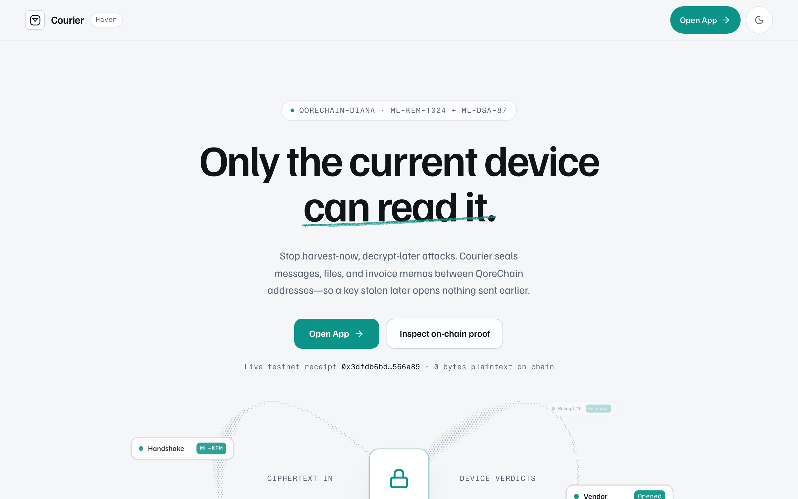
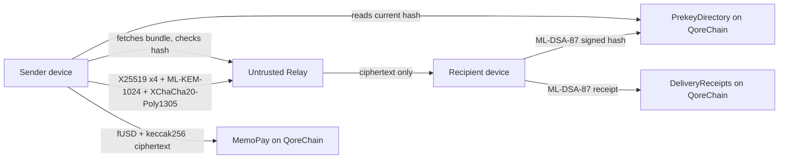

# Courier

**Courier sends encrypted invoices, files, and messages between QoreChain addresses, and can tie each one to an on-chain payment or signed delivery receipt. It checks the recipient's key bundle on chain before encrypting, so a relay can't quietly swap in its own key.**

Every recipient key bundle is bound on chain by an ML-DSA-87 signature, and every message is sealed client-side with ML-KEM-1024 and a double ratchet. A paid invoice leaves only its ciphertext hash on chain (`MemoPay`), and a recipient's optional ML-DSA-87 delivery receipt is checked on chain by `DeliveryReceipts`.

Tola sends a confidential invoice (`INV-0007.json`, 84 bytes) to a vendor through an untrusted relay. When the relay tries to swap in a different prekey bundle, Courier catches the mismatch and refuses before sealing a single byte — and when the invoice is paid, only a 32-byte ciphertext hash touches the chain, never the text.

[Live demo](https://courier-fawn-psi.vercel.app) · [Judge in 5 minutes](#judge-it-in-5-minutes) · [Run locally](#run-locally) · [What works today](#what-works-today)

<p align="center">
  <a href="https://courier-fawn-psi.vercel.app"></a>
</p>

| Tested on QoreChain Diana | Result |
| --- | --- |
| Lying relay swaps a recipient's prekey bundle | Refused locally with `BUNDLE_HASH` before anything was sealed |
| Directory publish or delivery receipt with one flipped signature byte | Reverted on chain with `SignatureInvalid` |
| One-time handshake, reply, and 84-byte invoice file | Delivered and verified end to end; one-time prekey secrets erased after use |
| Three-person group message, file, receipt, and member removal | Removed member's next post refused (`refused GROUP`) by all remaining devices |

Why not an existing messenger or plain encrypted chat? Harvest-now, decrypt-later is not the difference: Signal already adds ML-KEM to its handshake (PQXDH) and has added a post-quantum ratchet. The difference is who vouches for the keys. Signal-style messengers authenticate identity keys with classical signatures and hand out keys from the operator's central key server, which users trust unless they compare safety numbers. Courier binds each recipient's prekey bundle to their QoreChain address on chain with ML-DSA-87, so there is no key server to trust and the relay cannot swap a key without being refused. Messages, files, and invoices also tie into on-chain delivery receipts and payments (`MemoPay`, Haven Escrow), which a general chat app is not built for.

What is the biggest risk? Published prekey bundles expire after at most 7 days on chain and must be renewed (`npm run renew`), the relay can still drop or withhold traffic (its state now survives a restart, but availability is not protected), and one-way messages do not rekey until the peer replies (see [Known limits](#known-limits)).

How can a judge try it right now? Open [courier-fawn-psi.vercel.app/app/receipt](https://courier-fawn-psi.vercel.app/app/receipt) and click Verify all to check the vendor bundle, Carol's bundle, and the recorded delivery receipt live against QoreChain Diana with no wallet, or clone the repo and run `npm test` and `npm run evidence` (30 checks, 0 keys).

---

## Contents

1. [The problem](#the-problem)
2. [How it works](#how-it-works)
3. [Hardest technical decision](#hardest-technical-decision)
4. [Judge it in 5 minutes](#judge-it-in-5-minutes)
5. [Where each attack or failure stops](#where-each-attack-or-failure-stops)
6. [Rubric and track mapping](#rubric-and-track-mapping)
7. [What works today](#what-works-today)
8. [Known limits](#known-limits)
9. [Run locally](#run-locally)
10. [Repository map](#repository-map)
11. [Roadmap](#roadmap)
12. [Built during the hackathon](#built-during-the-hackathon)
13. [AI disclosure](#ai-disclosure)
14. [Evidence: testnet addresses](#evidence-testnet-addresses)
15. [Evidence: directory, exchange, MemoPay, group, and Escrow carry](#evidence-directory-exchange-memopay-group-and-escrow-carry)
16. [Evidence: bundle renewal calendar through judging](#evidence-bundle-renewal-calendar-through-judging)
17. [Evidence: design decisions and cost breakdown](#evidence-design-decisions-and-cost-breakdown)

---

## The problem

When two QoreChain accounts exchange a message, a deliverable file, or an invoice, they need a relay for delivery — and an untrusted relay can substitute a fake public key to intercept the handshake or archive ciphertext for harvest-now, decrypt-later decryption.

Courier makes the chain the root of key trust (`PrekeyDirectory` with ML-DSA-87 binding) and seals every message and file client-side with ML-KEM-1024 so the relay sees only ciphertext and never holds a valid key.

---

## How it works



- `PrekeyDirectory` (`src/PrekeyDirectory.sol`): stores one current canonical bundle hash (`keccak256`) per owner with an expiry (max 7 days). `publish` checks an ML-DSA-87 signature over `(chainid, directory, owner, hash, expiry)` via `pqcVerify`.
- Post-quantum handshake and ratchet: four X25519 agreements plus ML-KEM-1024 encapsulation to a one-time prekey (or the last-resort prekey when none remain). The long-term identity ML-KEM key is never an encapsulation target. Each direction keeps its own ratchet root; every 20 messages (or on suspected device copy), a fresh ML-KEM key is offered.
- Files: each file is encrypted with a random 32-byte key that travels inside the ratchet message.
- Groups and receipts (`src/DeliveryReceipts.sol`): admin-signed group membership on each device; removing a member stops future keys and refuses their later posts. Recipients sign a delivery receipt with ML-DSA-87 over the ciphertext hash and record it on `DeliveryReceipts`.
- `MemoPay` (`src/MemoPay.sol`): transfers fUSD in one call (holding 0 tokens itself) and stores `keccak256(ciphertext)` — 132 bytes of calldata, zero plaintext memo on chain.

---

## Hardest technical decision

Never encapsulating to the identity ML-KEM key, and refusing skipped-message keys.

Encrypting directly to a long-term identity KEM key makes implementation trivial, but any later compromise of that key unlocks every past message. Courier instead forces encapsulation to one-time prekeys (erased immediately after opening) or a rotating last-resort prekey, and refuses out-of-order/skipped message counters rather than caching old message keys. That costs recovery on dropped packets (that direction must restart) in exchange for a smaller key-exposure surface and simpler state guarantees.

---

## Judge it in 5 minutes

Everything below runs on QoreChain Diana (`qorechain-diana`, EVM chain ID `9800`) using test fUSD. If the live testnet RPC is unreachable, the replay still loads and displays `"Could not reach the testnet"` rather than a false pass (see [Known limits](#known-limits)).

1. Browser replay and live signature verification (no wallet, no setup): open [courier-fawn-psi.vercel.app/app/receipt](https://courier-fawn-psi.vercel.app/app/receipt) and click Verify all to check the vendor bundle publish, Carol's bundle publish, and delivery receipt `0x3dfdb6bd…566a89` directly against QoreChain Diana without calling the relay or holding a key.
2. One-command hash verification from a clone (no keys):
   ```bash
   git clone --recurse-submodules https://github.com/datharnu/courier
   cd courier
   npm ci
   npm run evidence
   ```
   On 21 November 2026 `npm run evidence` printed 30 passed, 0 failed.
3. Offline contract, protocol, lying-relay, and CBOM tests (no chain, no keys):
   ```bash
   npm test          # runs npm run test:ts (lying relay, ratchet, groups) + forge test
   npm run cbom:check
   ```
4. Local replay UI and local relay:
   ```bash
   npm run web       # replays the recorded group run (sends nothing)
   npm run relay     # local relay on 127.0.0.1:8787 reading qorechain-diana; state saved to .relay-state.json
   ```

---

## Where each attack or failure stops

- Relay swaps a recipient's bundle for another valid bundle: refused locally with `BUNDLE_HASH` against `PrekeyDirectory.current(owner)` before anything is sealed.
- Attacker flips a byte on a directory publish or delivery receipt signature: reverted on chain with `SignatureInvalid` (`0x37e8456b`).
- Attacker replays an already-recorded delivery receipt: second `record` call reverts on chain.
- Attacker steals a device key after a one-time handshake opened: one-time prekey secrets were already erased on open; past handshakes cannot be re-opened.
- Removed group member posts a new message: every remaining device refuses the post with `refused GROUP`.
- Stranger posts to a user's inbox: refused unless signed or valid under the conversation's AEAD; reading an inbox requires SIWQ + ML-DSA-87 sign-in.
- Observer inspects `MemoPay` calldata for invoice details: calldata is 132 bytes containing only `keccak256(ciphertext)`, never plaintext or plaintext hash.
- Restarted relay tries to hand out an already-used one-time prekey: `npm run relay` keeps handed-out entries in its state file across restarts; a relay that lost its state gets a fresh instance ID, and the owner signs the `spent` list on re-publish.
- Relay drops, reorders, duplicates, or replays a ratchet message, or flips a byte of its ciphertext, nonce, or header: refused with `COUNTER` or `AEAD`, and the session does not move, so the genuine message still opens (`test/ts/ratchet-refusals.test.ts`).

---

## Rubric and track mapping

Built for Build Before Q-Day (`https://build.qorechain.io/`), category bounty Encrypted Apps ("Build an application using post-quantum encryption for QoreChain-addressed recipients"; example projects include private messaging and document sharing). Deadline: 2 December 2026 at 23:59 UTC.

| Requirement (exact hackathon wording) | Where Courier proves it | Honest limit |
| --- | --- | --- |
| ML-KEM-1024 encryption | Handshake encapsulates with ML-KEM-1024 to a one-time prekey (or last-resort prekey); file keys travel inside ratchet messages, never sealed to a long-term key. | Identity KEM key is published only for card checks; ratchet limits are in [Known limits](#known-limits). |
| Registered recipient keys | `PrekeyDirectory` stores `keccak256` of canonical bundles; `current(owner)` is verified on chain before sealing ([addresses](#evidence-testnet-addresses)). | 7-day max bundle lifetime; see [renewal calendar](#evidence-bundle-renewal-calendar-through-judging). |
| ML-DSA key binding | `PrekeyDirectory.publish` and `DeliveryReceipts.record` verify ML-DSA-87 signatures via `pqcVerify`; flipped signature bytes revert `SignatureInvalid` (`0x37e8456b`). | Binding covers bundle hashes and receipt ciphertext hashes; message contents never touch the chain. |
| Client-side encryption and decryption | Clients seal and open all messages, files, and invoices locally; relay holds ciphertext only; `MemoPay` stores only `keccak256(ciphertext)` (132-byte calldata). | Safety numbers use SHA-256 (not Signal SHA-512); groups have no on-chain membership contract. |
| Public GitHub repository under MIT or Apache-2.0 | `https://github.com/datharnu/courier`, Apache-2.0 (`LICENSE`). | No QCAI dashboard audit has been run (not required for Encrypted Apps). |
| README, testnet addresses, and video (up to 3 min) | This single-file `README.md` holds all addresses, hashes, and limits; shot list in `docs/DEMO.md`. | Film not recorded yet; must be recorded and linked before 2 December 2026. |

---

## What works today

### Observed

- Deployed `PrekeyDirectory`, `MemoPay`, and `DeliveryReceipts` on `qorechain-diana` with two live bundles (vendor and Carol), and completed the live exchange, `MemoPay` payment, three-member group run, and Haven Escrow file carry ([full hashes and details](#evidence-directory-exchange-memopay-group-and-escrow-carry)).
- Live browser verification at `https://courier-fawn-psi.vercel.app/app/receipt` passed on 21 November 2026 at 390px and 1440px (0 horizontal overflow, 0 RPC errors).
- CLI checks passed on 21 November 2026: `npm run evidence` (30 passed, 0 failed), `npm run cbom:check`, and `npm test` (Foundry + `node:test` lying-relay suite).

### Built, not observed

- Browser-side bundle publishing for guest judges: planned design, not built yet; `/app/receipt` is read-only replay and live verification.

### Deliberately absent

- Durable hosted relay: the relay runs on `127.0.0.1` for local demos; `npm run relay` keeps its state in one local JSON file, not a hosted, replicated queue.
- Skipped-message key storage: dropped messages stall that direction rather than caching old keys.
- Retroactive history erasure on group removal: removed members retain messages and files they already decrypted.
- QCAI dashboard audit: not run on Courier contracts.
- Steward `PayGate` integration inside `MemoPay`: kept deliberately separate so `MemoPay` never holds tokens or modifies `PayGate` state.

---

## Known limits

- 7-day bundle expiry: `PrekeyDirectory` caps bundle lifetime at 7 days. Vendor's bundle expires 26 November 2026 at 20:11 UTC and Carol's expires 27 November 2026 at 11:45 UTC. Recorded hashes and signatures stay verifiable forever, while live `current()` requires renewal (`npm run renew -- --send`, before expiry) on the [renewal calendar](#evidence-bundle-renewal-calendar-through-judging).
- Relay storage and availability: `npm run relay` saves bundles, handed-out one-time entries, cards, inboxes, and files to `.relay-state.json` (set `RELAY_STATE_FILE` to move it, or `RELAY_STATE_FILE=memory` for the old in-memory behaviour), writing a temporary file and renaming it, so a restart keeps undelivered messages. Sign-in tokens are not saved, so clients sign in again. The whole file is rewritten on every change (fine for a demo, not for volume), inbox items are never pruned (each inbox stops at 1,000 items), and availability is still not protected: a relay can drop, withhold, or delete traffic.
- One-way talking without replies: no ML-KEM ratchet step completes until the peer replies; until then, messages rely on the symmetric chain.
- Last-resort prekey exposure: if all 20 one-time prekeys are exhausted, handshakes fall back to the last-resort prekey until the next bundle rotation.
- No skipped-message recovery: counters must match strictly; one lost message requires restarting that direction.
- Forwarded invoices: a vendor's signature binds the payee, not the messenger sender, so a forwarded invoice still verifies (payout stays locked to the signed payee).
- Safety numbers: SHA-256 based; not compatible with Signal's SHA-512 safety numbers.

---

## Run locally

Prerequisites: Node 22 and Foundry (`forge`).

```bash
git clone --recurse-submodules https://github.com/datharnu/courier
cd courier
npm ci
npm test              # TypeScript protocol + lying-relay tests, then forge test
npm run cbom:check    # verifies no ecrecover and only PQC precompiles
npm run evidence      # re-checks all 30 recorded testnet hashes (no keys)
npm run relay         # relay on 127.0.0.1:8787, state in .relay-state.json
npm run renew         # dry run: which project bundles expire within 48 h (sends nothing)
npm run web           # local replay UI (sends nothing)
```

Live scripts (`npm run live`, `npm run deploy:directory`, `npm run deploy:memopay`, `npm run deploy:receipts`, `npm run pay:memo`, `npm run live:group`) require `~/.haven/` keys and should not be re-run over recorded evidence.

---

## Repository map

| Path | Responsibility |
| --- | --- |
| `src/PrekeyDirectory.sol` | On-chain canonical bundle hash registry with ML-DSA-87 verification and 7-day max expiry |
| `src/MemoPay.sol` | Transfers fUSD and stores `keccak256(ciphertext)` (never holds tokens) |
| `src/DeliveryReceipts.sol` | Records one ML-DSA-87-signed delivery receipt per ciphertext hash |
| `src/BundleSpike.sol` | Earlier signed-bundle spike contract |
| `src/ts/` | X25519 + ML-KEM-1024 handshake, double ratchet, client, groups, invoices, safety numbers |
| `scripts/` | Local relay (file-backed), live exchange, live group, deploy, `renew-bundles.ts`, `evidence.ts` (30 checks), `cbom.ts` |
| `apps/web/` | Next.js replay and live browser receipt/bundle verifier (`https://courier-fawn-psi.vercel.app`) |
| `test/` & `test/ts/` | Foundry unit + invariant tests (`PrekeyDirectory`, `MemoPay`, `DeliveryReceipts`) and `node:test` protocol, ratchet-refusal, lying-relay, and relay-persistence tests |
| `deployments/` | Recorded testnet JSON reports and bundle snapshots |
| `vectors/protocol.json` | Pinned protocol byte vectors |

---

## Roadmap

1. Before 2 December 2026: record and publish the ≤3-minute demo film (`docs/DEMO.md`) and renew vendor/Carol bundles on schedule through judging.
2. Browser guest flow: let visitors publish ephemeral browser bundles and run live end-to-end exchanges in the browser.
3. Durable relay: replace the single local state file with hosted, replicated queues.
4. External audit: audit `PrekeyDirectory`, `MemoPay`, `DeliveryReceipts`, and the TypeScript ratchet before mainnet use.

---

## Built during the hackathon

Built during Build Before Q-Day (November 2026; deadline 2 December 2026 at 23:59 UTC). First commit: `97c05cc` on 19 November 2026 (`Add the Courier README.`). Licence: Apache-2.0 (`LICENSE`).

Credits: `@qorechain/sdk` 0.14.0, `@qorechain/pqc` 0.2.3, `@qorechain/qoreseal` 0.1.0, `@qorechain/qoresign` 0.1.0, `@qorechain/mcp` 0.1.1, `@qorechain/qorescan` 0.1.0; `haven-pq-kit` v0.1.0 (interface following `qore-pq-kit` by Adityaakr, Apache-2.0); `@noble/ciphers`, `@noble/hashes`, viem 2.47.6, `@cosmjs/stargate`, `forge-std`, TypeScript. Handshake follows the X3DH + ML-KEM-1024 shape and double-ratchet shape written fresh for QoreChain.

---

## AI disclosure

Written across Cursor agent sessions (Claude, including Claude Opus 5.5 on 20 Nov 2026) under human direction, with the human approving every network transaction, commit, and push; later README restructuring used Antigravity. Human decisions included fail-closed rules, strict counter matching (no skipped-message keys), keeping `MemoPay` separate from Steward's `PayGate`, using `haven-pq-kit` v0.1.0, and adding `courier-carol` for the group run. Bugs caught and fixed during development included signing the `spent` prekey list on republish, adding relay instance IDs for restart detection, and routing the swapped-key test through the real REST proxy.

---

## Evidence: testnet addresses

Network: `qorechain-diana` (EVM chain ID `9800`).

| Contract / Account | Address |
| --- | --- |
| `PrekeyDirectory` | `0x3d9a5821d0a24220a5f244a63a4a641d2acd9c2d` |
| `MemoPay` | `0x0fef978df64a5516e9f52ba1f4b2bbea6b7bd98c` |
| `DeliveryReceipts` | `0x06b52afc4a151b0efa260e2adcdf2d477632cb56` |
| fUSD (ERC-20, 6 decimals) | `0x97143B771D34ddb9130b807b135Ae675A5a963CA` |
| `spike` (deployer & group admin) | `qor143f0ghn8slqguwez73087dvq8lqnuuukqdu9fl` / `0xaC52f45E6787c08E3B22f45e7f35803Fc13e7396` |
| `steward-vendor` | `qor17zwvy05e9fzerfzksdkhygm92wvapwusvh4zfv` / `0xf09cc23e992A4591A456836D7223655399D0BB90` |
| `courier-carol` (removed in group run) | `qor1tacy6fv8x0jveznhdmyrqc2yep83awk07v3tf4` / `0x5f704d258733e4cc8a776ec8306144c84f1ebacf` |

- Vendor bundle hash: `0x9306826eb46977b32639a004ad992c868c5614d703fbb9a8e8cc08309b13e79f` (expiry `1795723898`, 26 Nov 2026 20:11 UTC).
- Carol bundle hash: `0x157c35bd5c1ffd5eb7606d33bc93183096184fc438155048e5d5bd5f07dbf6f0` (expiry `1795779952`, 27 Nov 2026 11:45 UTC).

---

## Evidence: directory, exchange, MemoPay, group, and Escrow carry

A lying relay that substituted another valid prekey bundle was refused locally (`BUNDLE_HASH`) before any byte was sealed. `MemoPay` sent 10,000 fUSD base units to the vendor with 0 bytes of plaintext memo on chain (only ciphertext hash `0x588d5e73…44e1eb6b`, distinct from plaintext hash `0x72e49759…86f9430`). In the 3-member group (`0x4d3a0e94…fe3314c0`), removing Carol caused both Spike and the vendor to refuse Carol's next post (`refused GROUP`). In the Haven Escrow cross-app carry, Courier sealed a file, `DeliveryReceipts` recorded ciphertext hash `0x7d0cf82a…58fb05b74`, and Haven Escrow released 100,000 fUSD base units to the stored freelancer.

| Step | Hash | Gas used | Notes |
| --- | --- | ---: | --- |
| Deploy `PrekeyDirectory` | `0x68e262aad138342bf1f299d28b4cd2fa01724c6fce69e2c6c4f9f65f11830d76` | 383,084 | First attempt with 1 uqor cap refused before broadcast (gas needed 43,097 uqor) |
| Vendor publish (20 one-time entries) | `0x1d38945c94ea384f8d0f4c1338d858d6edc7d34fd54cf2cf251242e44e61555e` | 280,769 | Flipped-byte `eth_call` reverted `SignatureInvalid` (`0x37e8456b`) beforehand |
| Carol publish | `0x994a39fc67a0082ac29cb0932ce95e1e4d8f1df0893325b808d4fb89b835adf0` | 280,805 | `live = true` read back |
| Deploy `MemoPay` | `0x09200f2613ea03f0b72a4c96a197ce511e170be268af66ceae9ae0f636919145` | 429,809 | Invariant: contract never holds tokens |
| Pool 2 swap for fUSD | `89BC9AABF4F23F63D5D5A2BB3E651BF5DCEF20DA843C8EEB36C2320A9AE1C38D` | — | Spent ≤400,000 uqor |
| Convert fUSD (`MsgConvertCoin`) | `576ACFBDE5A8AB4288F6043A15B5CABE18F71D33DFF74FB1E5D00A705767EBCC` | — | Hybrid PQC |
| Approve 10,000 fUSD | `0xb417daf32271680307666daa7d80d745a8acddac3c6d6857eadedc56dcf5777f` | — | To `MemoPay` |
| `MemoPay.pay` (10,000 fUSD) | `0xad3500fd93af8d5b95e51da69fe683382d2679c4291871ada7d7f06a31e245c4` | — | Ciphertext hash `0x588d5e7381c6e9412ab5b37063931fbc57ce930c26c1cfbc0d26d5d344e1eb6b`; timestamp `1795122861` |
| Group delivery receipt (`DeliveryReceipts`) | `0x3dfdb6bdf8a11a81792129083642f706a9b4547a62d4d8ebbe3eceb645566a89` | 288,262 | `recordedAt` `1795176375`; duplicate `record` reverted; flipped-byte `eth_call` reverted `0x37e8456b` |
| Escrow carry receipt (`DeliveryReceipts`) | `0x95a37e72f573830a73e491de42d0f7da7ad33713c80ed35d8626103c90391452` | — | For Haven Escrow `0x14312980702C0e2c9b85f3478ba9396e59054706`; ciphertext `0x7d0cf82a1ba8b2bddbf7b4c2f2cd356c877771494be8ac2181c1cd758fb05b74` |

Live exchange (`deployments/live-exchange.json`, 19 Nov 2026 20:47 UTC): conversation `0xea94595b…798d3fcd`, file `INV-0007.json` (84 bytes, hash `0x4a37b897…2662ca2a` matched), one-time entry 1 secrets erased. Used one-time entries across runs: vendor `0, 1, 2, 3`, Carol `0`.

---

## Evidence: bundle renewal calendar through judging

`PrekeyDirectory` enforces a 7-day maximum bundle lifetime, and accepts a new publish at any time, so project bundles are renewed before they expire rather than after.

`npm run renew` (`scripts/renew-bundles.ts`) reads `PrekeyDirectory.current(owner)` for the vendor and Carol and their uqor balances, using read-only calls and no keys, and prints which bundles expire within the window (default 48 hours, `--within <hours>`). It sends nothing unless given `--send`:

```bash
npm run renew                  # dry run: shows what is due, sends nothing
npm run renew -- --send        # publishes a fresh bundle for each owner inside the window (needs ~/.haven/ keys)
```

On 23 November 2026 at 09:31 UTC (chain time) the dry run reported the vendor at 82.7 hours left and Carol at 98.2 hours left, so nothing was due inside 48 hours. With `--within 120` it reported that the vendor would first be funded from `spike` (vendor balance 378,413 uqor, below the script's 600,000 uqor minimum).

Each renewal costs 360,000 uqor for the window open and close plus EVM gas (the first publishes used about 281,000 gas). A renewal is appended to `deployments/renewals.json`, which `npm run evidence` then re-checks with the rest, so its count rises above 30. The recorded first publishes in `deployments/prekey-directory.json` and `deployments/prekeys-courier-carol.json` are not rewritten. The new public bundle replaces `deployments/bundles/<owner>.json` (the previous one is kept in `deployments/bundles/archive/`), and the new prekey secrets replace `~/.haven/courier/<owner>.prekeys.json`. A running relay and live devices need the new bundle published to them again.

Planned schedule (not yet run). Each run renews to 7 days ahead, so the next run falls due 5 days later; when nothing is due the dry run prints `Run again after <time>`, so run it first each time:

| Date (UTC) | Command | Expected result |
| --- | --- | --- |
| 25 Nov 2026, after 11:45 | `npm run renew -- --send` | Vendor and Carol both inside 48 hours; both renewed to about 2 Dec |
| 30 Nov 2026 | `npm run renew -- --send` | Both renewed to about 7 Dec |
| 5 Dec 2026 | `npm run renew -- --send` | Both renewed to about 12 Dec |
| 10 Dec 2026 | `npm run renew -- --send` | Both renewed to about 17 Dec |

---

## Evidence: design decisions and cost breakdown

| Decision | Why |
| --- | --- |
| Identity KEM key is never an encapsulation target | Prevents a single long-term key compromise from decrypting historical handshakes |
| Separate ratchet root per direction | A KEM rekey in one direction never invalidates in-flight replies from the other |
| Store `keccak256(ciphertext)` on `MemoPay`, never plaintext | Prevents on-chain calldata from leaking invoice contents or matching plaintext hashes |
| No skipped-message keys | Keeps key state minimal; a dropped message stalls instead of holding old keys |
| Admin-signed group state on devices | Avoids on-chain membership leaks; removal stops future keys without claiming history deletion |

Measured costs on `qorechain-diana` (protocol fee: 0):

- Native window open + close: 180,000 uqor each (360,000 uqor per EVM action).
- `PrekeyDirectory` deploy: 383,084 gas (43,097 uqor).
- Bundle publish: 280,769 gas (vendor) / 280,805 gas (Carol).
- `MemoPay` deploy: 429,809 gas.
- `DeliveryReceipts.record`: 288,262 gas.
